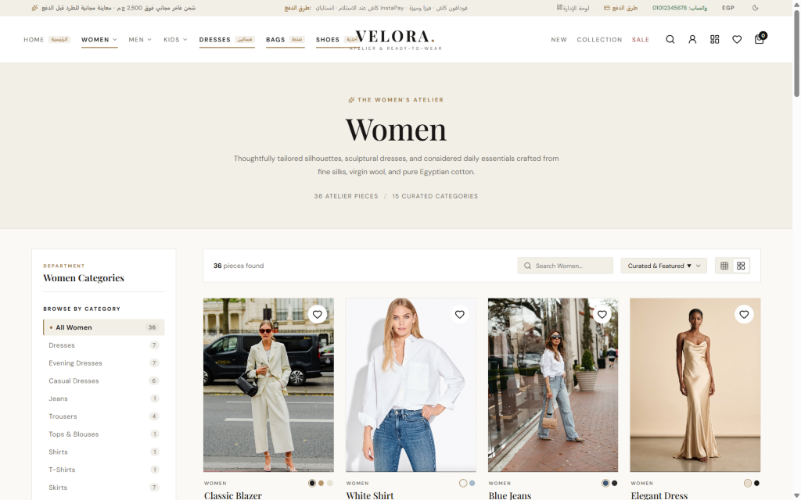
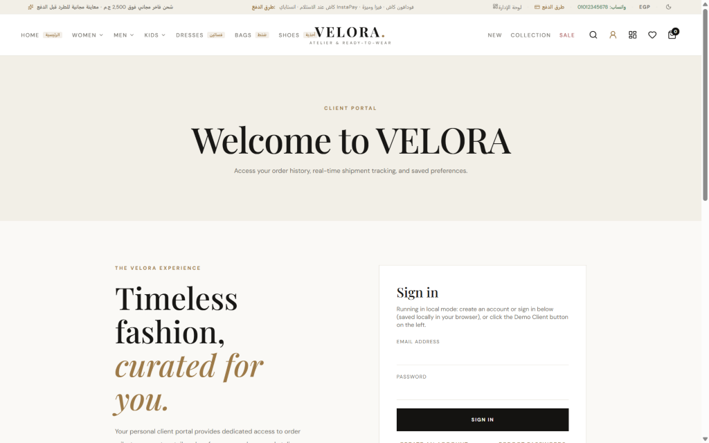
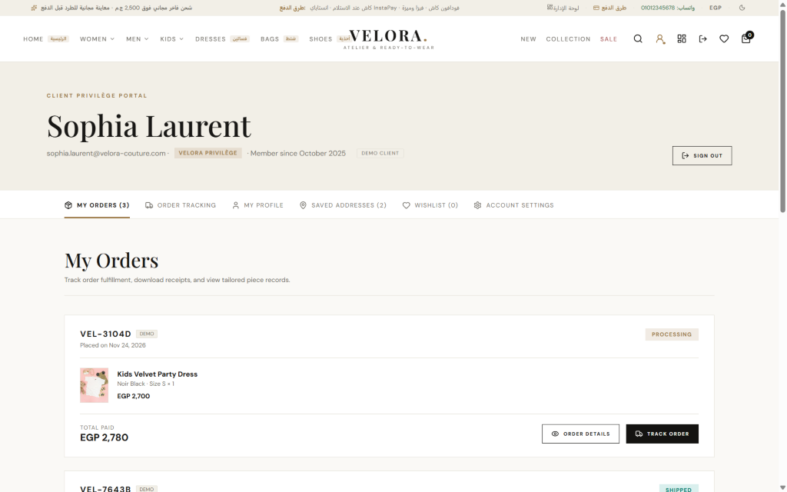
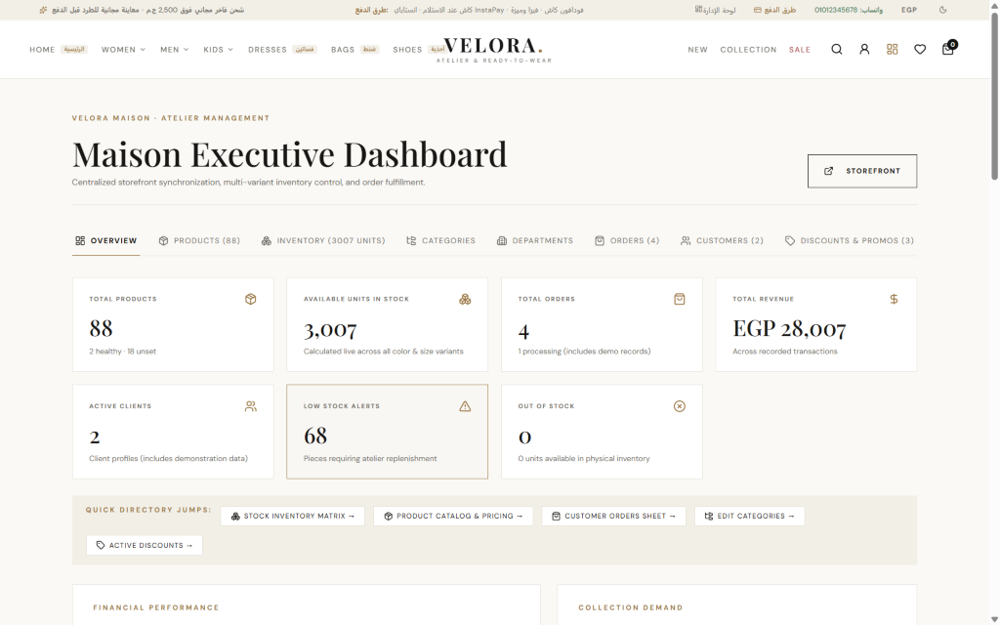

<div align="center">

# VELORA. — Luxury Atelier & Ready-to-Wear Storefront

**A modern, full-featured luxury fashion e-commerce storefront built with React 19, Vite, React Router, and optional Firebase Auth & Firestore.**

[](https://react.dev/)
[](https://vite.dev/)
[](https://firebase.google.com/)
[](https://lucide.dev/)

</div>

---

## Visual Showcase

### 1. Editorial Storefront & Mega-Menu Navigation
<p align="center">
  
</p>

### 2. Curated Catalog, Filtering & Multi-Currency (EGP / USD)
<p align="center">
  
</p>

### 3. Client Authentication Portal (Email/Password, Google OAuth & Demo Access)
<p align="center">
  
</p>

### 4. Client Privilège Dashboard (Orders, Live Tracking, Profile & Saved Addresses)
<p align="center">
  
</p>

### 5. Maison Executive Admin Dashboard (KPIs, Inventory Matrix, Orders & Promos)
<p align="center">
  
</p>

---

## Key Features

### Storefront & Shopping Experience
- **Multi-Department Catalog**: Women, Men, Kids, New Arrivals, Full Collection, Sale, and dynamic custom departments created from the Admin panel.
- **Smart Filtering & Search**: Instant search overlay, subcategory filtering, price/size filters, and sorting.
- **Interactive Product Details**: Multi-angle product gallery (`ProductGallery`), size & color selection, **Fit Finder** (`FitFinder`) sizing assistant, and real-time variant stock availability.
- **Cart, Wishlist & Checkout**: Persistent shopping bag and wishlist, promo code support, Egyptian shipping zones (`Cairo & Giza`, `Alexandria & Delta`, `Upper Egypt & Canal`, etc.), and localized payment methods (**Cash on Delivery with free inspection**, **InstaPay**, **Vodafone Cash**, and **Card**).
- **Theme & Currency Switcher**: Instant Light/Dark mode toggle and live **EGP / USD** currency conversion.

### Client Portal & Authentication (`/account`)
- **Dual-Mode Auth**:
  - **Local Mode (out-of-the-box)**: Full Email/Password registration & sign-in persisted in the browser, plus one-click **Demo Client** preview (*Sophia Laurent*).
  - **Firebase Mode (production-ready)**: Plug in your `.env` keys to enable Firebase Email/Password, Password Reset, and Google Sign-In.
- **Customer Dashboard**: Order history, step-by-step shipment tracking, profile preferences, saved delivery addresses, and wishlist management.

### Admin Executive Dashboard (`/admin`)
- **Executive Overview**: Live revenue, order count, available inventory units, and best-selling pieces.
- **Product & Inventory Matrix**: Create, edit, and delete products; adjust per-size/per-color stock levels with low-stock alerts.
- **Categories, Departments & Promotions**: Dynamically manage subcategories, custom top-level departments, and discount promo codes.
- **Order Management**: Inspect customer orders, view printable invoices, and update fulfillment statuses (`Awaiting payment` -> `Processing` -> `Confirmed` -> `Shipped` -> `Delivered`).

---

## Tech Stack

- **Frontend**: React, React Router (`react-router-dom`), Lucide React (`lucide-react`)
- **Build Tool**: Vite
- **Backend / Persistence (Optional)**: Firebase Authentication & Cloud Firestore (with automatic localStorage / IndexedDB / sessionStorage fallback for local demo mode)
- **Styling**: Modular CSS (`styles.css`, `header-responsive.css`, `features.css`, `gallery.css`, `dashboards.css`)

---

## Project Structure

```text
velora-react/
├── docs/
│   └── screenshots/          # Storefront & dashboard screenshots
├── public/                   # Static assets
├── src/
│   ├── components/           # Header, Footer, ProductCard, ProductGallery, ProductModal, FitFinder, Toast
│   ├── context/              # AuthContext, StoreContext, ThemeContext
│   ├── data/                 # Product catalog & category tree
│   ├── pages/                # Home, Listing, ProductDetail, Cart, Checkout, Account, Admin, Wishlist, Contact
│   ├── services/             # Payment methods configuration
│   ├── utils/                # Orders, inventory, addresses, promotions, sizing, formatting, storage helpers
│   ├── App.jsx               # Application routes & layout
│   ├── firebase.js           # Firebase initialization & admin email helpers
│   └── main.jsx              # Entry point
├── env.example               # Environment variable template
├── firestore.rules           # Firestore security rules
└── package.json
```

---

## Getting Started

### 1. Prerequisites
- **Node.js** 18+ and **npm**

### 2. Install & Run Locally
```bash
git clone https://github.com/malak7895/velora-react.git
cd velora-react
npm install
npm run dev
```
Open the local URL printed by Vite (default: `http://localhost:5173`).

### 3. Optional: Enable Firebase Auth & Firestore
Copy `env.example` to `.env` and fill in your Firebase web app credentials:
```env
VITE_FIREBASE_API_KEY=your_api_key
VITE_FIREBASE_AUTH_DOMAIN=your-project.firebaseapp.com
VITE_FIREBASE_PROJECT_ID=your_project_id
VITE_FIREBASE_APP_ID=your_app_id
VITE_TRANSFER_NUMBER=01012345678
VITE_ADMIN_EMAILS=admin@example.com
```
If `.env` is left empty, the app runs seamlessly in local demo mode with browser persistence.
